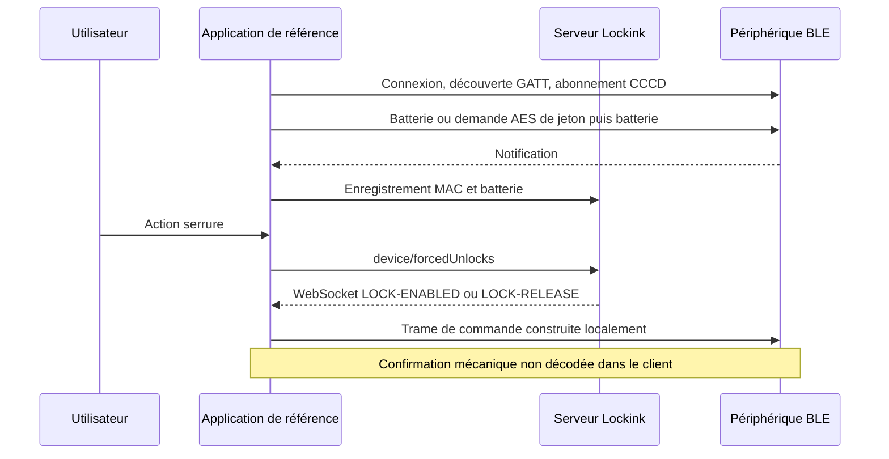

# Protocole Bluetooth retrouvé dans Lockink 1.5.7

## Portée et niveau de preuve

Analyse statique du fichier fourni `lockink-157.apk`, réalisée le 14 novembre 2026. Le code permet de reconstituer les commandes émises ; il ne démontre ni leur acceptation par votre serrure, ni leur effet mécanique. Aucune capture matérielle, connexion à une serrure ou requête au serveur Lockink n'a été réalisée.

| Élément | Valeur observée |
| --- | --- |
| SHA-256 APK | `555da254ebbaf2bb791946042b8ae6f73ebeba22df2d517d5e4c28f7ec763f64` |
| Taille | 73 843 307 octets |
| Package Android | `com.lockink.phonelive` |
| Version / code | `1.5.7` / `61` |
| Android min / cible | API 21 / API 34 |
| Code | Quatre DEX ; logique BLE identifiée dans `classes3.dex` |
| Outils | OpenJDK 21.0.13, JADX 1.5.6, Apktool 3.0.3 |

L'identité et la version sont corroborées par `AndroidManifest.xml`, `apktool.yml` et `com.weather.life.BuildConfig`. L'authenticité par rapport à une distribution officielle n'est pas établie par cette analyse.

**S** signifie « établi dans le code statique », **H** « interprétation à confirmer », **M** « à mesurer sur matériel ». Aucun résultat n'a encore le niveau de preuve matériel. Toutes les trames ci-dessous sont des octets hexadécimaux, les offsets commencent à zéro, `??` désigne un octet inconnu. Les noms « ancien », « nouveau » et « classique » reprennent les branches du code ; ils ne datent pas les firmwares.

## Sources et reproduction

Les chemins Java cités sont relatifs à `analysis/lockink-157/jadx/sources/com/weather/life/`. Les chemins smali sont relatifs à `analysis/lockink-157/apktool/smali_classes3/com/weather/life/`. Ces sorties locales sont ignorées par Git et se régénèrent avec [le script](../scripts/analyse-apk.sh). Le script exige quatre chemins explicites dans le workspace et refuse d'écraser une sortie existante.

Outils existants comparés : [JADX](https://github.com/skylot/jadx) pour suivre le Java, [Apktool](https://apktool.org/wiki/the-basics/decoding/) pour les ressources et le smali ; alternative externe : [Androguard](https://github.com/androguard/androguard). Le couple JADX/Apktool est retenu pour croiser lecture de haut niveau et instructions DEX. Les outils opam, Containers et la bibliothèque standard OCaml n'apportent pas de décompilation Android nécessaire ici. Aucun parseur, chiffrement ou algorithme standard n'est réimplémenté ; aucune dépendance applicative n'est ajoutée.

Les distributions utilisées sont celles des releases officielles :

| Artefact | SHA-256 calculé localement |
| --- | --- |
| `jadx-1.5.6.zip` | `545ea2be9c242511bc145755cf4bda2485ade42966e096f8b4d3da2a230e8974` |
| `apktool_3.0.3.jar` | `dbf930b076c6b9be08d57c449cacefc3bdd6b71ebd59b3066fc0e1f5b14f9423` |

Depuis la racine du dépôt, pour télécharger ces versions et reproduire l'analyse dans une **nouvelle** sortie :

```bash
mkdir -p analysis/tools
curl -fL https://github.com/skylot/jadx/releases/download/v1.5.6/jadx-1.5.6.zip -o analysis/tools/jadx-1.5.6.zip
unzip -q analysis/tools/jadx-1.5.6.zip -d analysis/tools/jadx-1.5.6
curl -fL https://github.com/iBotPeaches/Apktool/releases/download/v3.0.3/apktool_3.0.3.jar -o analysis/tools/apktool_3.0.3.jar
sha256sum lockink-157.apk analysis/tools/jadx-1.5.6.zip analysis/tools/apktool_3.0.3.jar
bash scripts/analyse-apk.sh lockink-157.apk analysis/tools/jadx-1.5.6/lib/jadx-1.5.6-all.jar analysis/tools/apktool_3.0.3.jar analysis/reproduction
```

Si les outils sont déjà extraits, ne pas répéter les téléchargements/extractions. Les chemins ci-dessus décrivent l'organisation choisie pour cette analyse, pas une configuration de l'application. Le script place les caches, le répertoire Java et les temporaires sous la sortie et désactive les compteurs JVM écrits dans `/tmp`.

La première décompilation JADX se termine avec le code **3 et 122 erreurs** ; la reproduction par script termine avec le code **3 et 120 erreurs**. Apktool réussit dans les deux cas. Le nombre d'erreurs JADX varie entre les passes ; ces sorties ne sont pas un build de l'application. Le code Java contient notamment des erreurs de typage (`bArr == 0`) et une reconstruction de boucle invalide dans le scan. Ces extraits ne sont pas du Java à intégrer au projet. Les constructeurs de trames, l'AES, la conversion du timer et le décodage batterie/jeton ont été recoupés avec le smali. Consulter `jadx.log`, `apktool.log`, `provenance.txt` et `status.txt` dans la sortie du script, même si celui-ci termine avec un statut non nul.

| Référence | Sources déterminantes |
| --- | --- |
| P1 | `ble/BleController.java` : UUID lignes 37–45, `connect`, `BleGattCallback`, `enableNotification`, `writeBuffer*` |
| P2 | `ble/BindBlePresenter.java` : constantes lignes 38–75, constructeurs lignes 363–385, 437–447, 545–559, 583–674, 720–728 |
| P3 | `activity/BindDeviceActivity.java` : `initData` lignes 91–203, `initBluetooth` lignes 297–359 ; smali `activity/BindDeviceActivity$2$1.smali`, `onReceiver` |
| P4 | `activity/MainActivity.java` : `initView` lignes 137–252 ; `ble/BindBlePresenter.java`, `startHeartBeat`, `pollBLE` |
| P5 | `activity/DeviceControlActivity.java` : `onClick`, `getDataSuccess`, `initWebSocket`, `onLockChange`, `onTimeLockChange` ; `presenter/home/DeviceControlPresenter.java`, `toggleLock` |
| P6 | `activity/DeviceControlActivity4.java` lignes 504–533 ; `DeviceControlActivity5.java` lignes 485–513 ; `DeviceControlActivity7.java` lignes 552–575 |
| P7 | `util/AESECBEncryption.java` et `.smali` ; `ble/BindBlePresenter.smali` : `generateCommand` ligne 782, `generateCommand2` ligne 890 |
| P8 | `fragment/HomeFragment.java` lignes 99–124 ; `presenter/home/BindDevicePresenter.java`, `save` ; `presenter/login/MainPresenter.java`, `save` |
| P9 | `common/ServerConfig.java`, `retrofit/ApiStores.java`, `retrofit/MyInterceptor.java`, `socket/JWebSocketClient.java` |
| P10 | `ble/DeviceBehavior.java`, `behavior/BehaviorTracker.java`, `behavior/BehaviorConfig.java`, `util/SpUtil.java` |

Les numéros de lignes Java dépendent de la version de JADX. Les noms de classe/méthode et le SHA de l'APK sont les repères stables. Dans le smali de `BindBlePresenter`, les constructeurs `setAction*` commencent ligne 1167, `setActionData*` ligne 1816 et `setCommand*` ligne 1966.

## Découverte et variantes

**S — P1, P3, P8.** Scan via `BluetoothAdapter.startLeScan`, sans filtre UUID ; `BleDevceScanCallback` retransmet appareil, RSSI et annonce brute. L'écran filtre par `BluetoothDevice.getName()`, déduplique par adresse et rapproche les noms de la liste serveur par MAC. Aucun décodage de manufacturer data n'est utilisé dans cette branche. Le scan dure nominalement 60 secondes.

| Nom BLE reconnu | Écran de contrôle depuis `HomeFragment` | Initialisation batterie |
| --- | --- | --- |
| `AA-A1001`, `AA-A1002` | `DeviceControlActivity` | `1002` : famille B ; sinon A |
| `AA-A1003` | `DeviceControlActivity2` | A |
| `AA-A1004`, `AA-A1006` à `AA-A1011`, `AA-A1014`, `AA-A1016`, `AA-A1017` | `DeviceControlActivity4` | A |
| `AA-A1005` | `DeviceControlActivity5` | famille C |
| `AA-A1012` | `DeviceControlActivity6` | A |
| `AA_A1013` (underscore) | `DeviceControlActivity7` | famille E, AES |
| `AA-A1015` | `DeviceControlActivity8` | A |

Le nom de votre serrure et son firmware restent **M**. Un écran peut appeler plusieurs formats selon l'opération ; le routage ci-dessus ne prouve pas la compatibilité de chaque commande sur chaque appareil. Les commandes électriques, de rotation et de vibration appartiennent aussi à l'application de référence : leur présence ne prouve pas que la serrure les supporte.

## Transport GATT

**S — P1.** Deux services propriétaires :

| Rôle | Service classique | Service « NEW » |
| --- | --- | --- |
| Service | `00008ac0-0000-1000-8000-00805f9b34fb` | `8653000a-43e6-47b7-9cb0-5fc21d4ae340` |
| Écriture | `00008ac1-0000-1000-8000-00805f9b34fb` | `8653000c-43e6-47b7-9cb0-5fc21d4ae340` |
| Notifications | `00008ac2-0000-1000-8000-00805f9b34fb` | `8653000b-43e6-47b7-9cb0-5fc21d4ae340` |
| Lecture explicite définie | même UUID que notifications | pas de méthode de lecture dédiée trouvée |
| CCCD | `00002902-0000-1000-8000-00805f9b34fb` | même UUID |

Connexion par MAC avec `connectGatt(context, false, callback)` ; demande de priorité haute (`1`), découverte des services, recherche de la caractéristique de notification classique, puis NEW si absente. Activation locale des notifications et écriture CCCD `01 00`. Il ne s'agit pas d'une activation des indications.

`writeBuffer` utilise la caractéristique classique sans modifier son type d'écriture ; il faut mesurer le type ATT réel. `writeBufferNoRespon` cible NEW et impose `WRITE_TYPE_NO_RESPONSE` (`1`). `writeBufferNew` existe mais aucun appel n'a été trouvé dans les smali applicatifs. Les notifications sont diffusées telles quelles à tous les listeners enregistrés ; leurs clés sont des identifiants de callbacks, pas des identifiants de transaction.

Les caractéristiques sont résolues à la demande et partagent un cache `mBleGattCharacteristic` entre méthodes. `reset()` ne vide pas ce cache et un seul `writeCallback` est conservé. Une implémentation future devra gérer la disponibilité GATT et les opérations en cours explicitement ; ce client ne définit pas une file fiable de transactions ni une bascule automatique sûre entre profils.

Aucun appel applicatif à `createBond`, RFCOMM ou `requestMtu` n'a été trouvé. Cela ne démontre pas l'absence de sécurité imposée par le périphérique : appairage système, chiffrement du lien et propriétés GATT restent **M**. Les trames construites font au plus 20 octets. `splitData` existe mais aucun appel n'a été retrouvé ; pas de fragmentation/réassemblage applicatif actif identifié.

L'application annonce la connexion dès `STATE_CONNECTED`, avant fin de découverte et abonnement. Elle attend ensuite **3 secondes** avant la requête initiale de batterie ou de jeton. Le timeout de connexion nominal est **10 secondes**. `reConnect()` signale un échec au callback ; cette méthode ne relance pas elle-même `connectGatt`. Ne pas prendre ces délais de l'APK pour des exigences démontrées du firmware.

## Famille A : trames fixes de dix octets

**S — P2, P5, P6.** Format émis :

```text
offset : 00 01 02 03 04 05 06 07 08 09
trame  : AA 09 OP P0 P1 P2 P3 P4 P5 FF
```

`09` et `FF` sont constants dans les constructeurs. L'interprétation de `09` comme longueur et de `FF` comme délimiteur reste **H** ; aucun calcul de checksum/CRC n'est effectué ici. Les paramètres sont convertis par `Integer.byteValue()` : le code ne valide pas les plages à ce niveau.

| OP | Fonction / méthode | P0 P1 P2 P3 P4 P5 |
| --- | --- | --- |
| `01` | Électrique, `writeElectricData` / `writeElectricData2` | fréquence, mode continu (`01`/`00`), tension, durée, `00 00` |
| `02` | Déverrouiller, `writeLockData(mac,false)` | `00 00 00 00 00 00` |
| `03` | Verrouiller, `writeLockData(mac,true)` | `00 00 00 00 00 00` |
| `04` | Timer serrure, `writeTimerData` | minutes haut, minutes bas, `01 01`, tension de libération, `02` |
| `04` | Timer électrique, `writeTimerElectricData` | minutes haut, minutes bas, fréquence, tension de libération, shockMinute haut, shockMinute bas |
| `05` | Batterie, `checkBattery` | `00 00 00 00 00 00` |
| `06` | Mode classique, `writeCommand` | fréquence vibration, intensité vibration, fréquence électrique, tension, `00 00` |
| `08` | Mode berserk, `writeCommand2` | activation (`01`/`00`), `00 00 00 00 00` |
| `09` | Mode aléatoire, `writeCommand3` | activation (`01`/`00`), tension min, tension max, `00 00 00` |
| `0E` | Lumière, `writeCommand4(Integer)` | valeur `inLantern`, `00 00 00 00 00` |

Les unités électriques, la durée, les domaines de fréquence et les valeurs de lumière ne sont pas établis physiquement. Les labels viennent des getters des messages réseau, pas de mesures. Dans plusieurs écrans, une durée électrique nulle est remplacée par `1` avant l'appel.

**Conversion du timer à préserver :** `new BigDecimal(seconds).divide(new BigDecimal(60), 4).intValue()` appelle la surcharge dont `4` est le mode `ROUND_HALF_UP`, avec une échelle zéro. Il s'agit d'un arrondi à la minute la plus proche : 29 s → 0, 30 s → 1, 89 s → 1, 90 s → 2. Ce n'est pas une division entière tronquée. Les deux octets sont extraits de l'hexadécimal complété à quatre chiffres, octet fort d'abord. Le traitement de valeurs hors 16 bits n'est pas une validation robuste. `shockMinute` est encodé directement dans le même ordre, sans division par 60. Sources smali : `writeTimerData`, appel `BigDecimal.divide` ligne 3334 ; `writeTimerElectricData` ligne 3503.

Exemples **construits depuis le code, non capturés** :

```text
Batterie       AA 09 05 00 00 00 00 00 00 FF
Déverrouiller  AA 09 02 00 00 00 00 00 00 FF
Verrouiller    AA 09 03 00 00 00 00 00 00 FF
```

Réponse batterie : les handlers testent `response[2] == 05`, puis lisent `response[3]` comme entier non signé et plafonnent à 100. On sait seulement que le préfixe exploité est `?? ?? 05 BAT` ; le code ne prouve ni l'en-tête, ni la longueur complète, ni la terminaison de la notification.

## Famille B : ancien format `AA`, notamment `AA-A1002`

**S — P2, P3, P5.** Pas de longueur ni de terminaison ajoutées par les constructeurs.

| Fonction | Trame | Méthode |
| --- | --- | --- |
| Batterie | `AA 03` | `checkBatteryOld(realName,callback)` |
| Serrure | `AA 01 O V` | `writeLockDataOld(mac,closed,V)` ; `O=00` si closed, `01` sinon |
| Électrique | `AA 02 C F V D` | `writeElectricDataOld` ; continu, fréquence, tension, durée |

Dans `DeviceControlActivity.onLockChange`, le cas `AA-A1002` n'émet rien pour le verrouillage et émet `AA 01 01 00` pour l'ouverture. Dans le callback `onTimeLockChange`, une ouverture temporisée transmet `TimeSocketBean.unlockVoltage` à la même commande. `TimeSocketBean` contient séparément `timeLockReleaseSeconds` et `unlockVoltage` : ce dernier n'est donc pas la durée du timer. Son nom et sa position dans le champ `V` indiquent une tension/valeur de libération configurable, possiblement liée à la force d'actionnement, mais son unité et son effet mécanique exact ne sont pas établis par le code. La commande d'ouverture manuelle observée utilise zéro. Le constructeur sait encoder `AA 01 00 V`, mais le handler d'interface retourne sans l'envoyer lorsqu'on demande la fermeture sur `AA-A1002` ; une fermeture effective n'est donc pas établie.

Réponse batterie : `response[1] == 03`, batterie dans `response[2]`. Le code traite ici le byte Java comme signé et borne entre 0 et 100. Préfixe réellement testé : `?? 03 BAT` ; les autres octets restent inconnus.

## Famille C : format court de `AA-A1005`

**S — P2, P3, P6.** Constructeurs distincts, également envoyés au service classique.

| Fonction | Trame | Méthode |
| --- | --- | --- |
| Batterie | `AA 00` | `checkBattery3` |
| Classique | `AA 01 FS IS FE V` | `writeCommand4(mac,spinFrequency,spinIntensity,electricFrequency,voltage)` |
| Berserk | `AA 02 E` | `writeCommand5` |
| Aléatoire | `AA 03 E MIN MAX` | `writeCommand6` |
| Rotation | `AA 04 IS V DIR` | `writeCommand7` |

`E` est l'activation booléenne, `FS`/`IS` la fréquence/intensité de rotation, `FE` la fréquence électrique, `V` la tension, `DIR` la direction. Le mapping physique des valeurs de direction et les plages restent **M**. Les handlers d'initialisation lisent directement `response[2]` comme batterie, sans vérifier de code opération ; ils plafonnent à 100 sans conversion non signée. Ne pas transformer cette lecture permissive en preuve du format complet de réponse.

## Famille D : constructeurs indexés présents, usage non retrouvé

**S — P2 et recherche des références smali.** `checkBattery2` construit et envoie la première trame ; aucun appel de `checkBattery2` ou de `setCommand2/3/4` n'a été retrouvé dans le code applicatif. Cette famille n'est pas attribuée à un modèle.

| Constructeur | Octets émis / construits |
| --- | --- |
| `setCommand()` | `IX 01 00 01 00 05 0B 00` |
| `setCommand2(a,b,c,d)` | `IX 01 00 03 00 01 11 a 00 02 11 b 00 03 11 c 00 04 11 d` |
| `setCommand3(a)` | `IX 01 00 01 00 07 11 a` |
| `setCommand4(a,b)` | `IX 01 00 01 00 08 22 a b` |

`IX` commence à 1 et passe de 255 à 1. Seul `checkBattery2` incrémente l'index après soumission de l'écriture. La constante que JADX nomme `AbstractJceStruct.STRUCT_END` vaut bien `0B` dans le smali ; ce nom importé ne prouve pas l'utilisation de JCE/Tars par le périphérique. Sens des champs, réponses et compatibilité : inconnus.

## Famille E : `AA_A1013`, blocs AES de seize octets

**S — P2, P3, P4, P7.** `getToken`, `writeCommand8` et `checkBatteryNew` chiffrent des tableaux binaires par **AES-128/ECB/NoPadding** puis les écrivent sans réponse sur le service NEW. La clé embarquée dans cet APK est :

```text
8F2A1C7B4D5E9063C8B7A6D5E4F32109
```

Ce sont 16 octets décodés depuis l'hexadécimal, pas 32 caractères UTF-8 utilisés comme clé. Pas d'IV, de padding PKCS ni de Base64 sur le chemin BLE : les surcharges String de la classe crypto font du Base64, mais les méthodes BLE appellent les surcharges `byte[]`. Pas de MAC cryptographique supplémentaire trouvé dans ces constructeurs. Aucune dérivation par appareil ou clé obtenue du serveur n'y apparaît.

### Demande du jeton

Texte clair de `generateCommand()` :

```text
offset : 00 01 02 03 04 05 06 07 08 09 10 11 12 13 14 15
clair  : 00 E1 01 00 TS TS TS TS 00 00 00 00 00 00 00 00
```

Le timestamp est `System.currentTimeMillis()/1000` converti en hexadécimal, puis les quatre premiers octets sont copiés en ordre fort d'abord. Pour les dates actuelles cela encode les secondes Unix sur 32 bits. Le code suppose une chaîne hexadécimale paire d'au moins quatre octets ; il ne définit pas un encodage robuste pour toutes les dates.

Une notification déchiffrée de longueur 16 dont l'octet 2 vaut `01` provoque la copie des octets **4 à 7** dans `mToken`. Le handler appelle ensuite `checkBatteryNew`. Les autres champs, dont le statut de cette réponse, ne sont pas validés par le handler. La génération et la durée de validité du jeton côté périphérique restent **M**.

### Commande avec jeton

Texte clair de `generateCommand2(channel,frequency,voltage)` :

```text
offset : 00 01 02 03 04 05 06 07 08 09 10 11 12 13 14 15
clair  : 00 E1 04 T0 T1 T2 T3 CH FR VO 00 00 00 00 00 00
```

`mToken` est un tableau de quatre octets en mémoire du singleton, initialement nul. Aucune persistance, remise à zéro à la déconnexion ou validation préalable de sa présence n'est trouvée dans le presenter. Il ne faut pas confondre ce jeton BLE avec le token HTTP du compte.

`writeCommand8` reçoit `channel`, `frequency`, `voltage` depuis le message réseau `QIUI-COLLAR-CONTROL` dans `DeviceControlActivity7`. `checkBatteryNew` réutilise exactement ce constructeur avec **`CH=01 FR=00 VO=01`**. Cette combinaison est donc bien celle utilisée pour obtenir la batterie par l'APK ; son effet physique doit être confirmé avant une utilisation indépendante. Aucun constructeur AES de verrouillage/déverrouillage distinct n'a été retrouvé.

Pour une notification déchiffrée de longueur 16, les handlers reconnaissent `plain[2] == 04` et `plain[3] == 00`, puis lisent la batterie dans **`plain[15]`**. `plain[3]==00` est traité comme condition de succès, sans table d'erreurs. La batterie est lue comme byte signé et plafonnée à 100, sans borne basse. Les autres réponses sont ignorées ; leur signification est inconnue.

Deux vecteurs **synthétiques**, validés avec la classe AES décompilée et indépendamment avec OpenSSL, pour vérifier l'encodage crypto sans appareil :

| Clair | Chiffré AES-ECB |
| --- | --- |
| `00e10100650000000000000000000000` | `a27dff7d65125defaa8d613f15f8104f` |
| `00e10401020304010001000000000000` | `a3cdb8132b5a807b861c49aea629ccc7` |

Le timestamp `65000000` et le jeton `01 02 03 04` sont des données de test, sans lien avec une serrure ni des secrets utilisateur. Le second vecteur utilise la combinaison batterie décrite ci-dessus. Ces vecteurs ne prouvent pas qu'un firmware accepte ces messages.

## Réponses, état et erreurs

**S — P1 à P5.** `onCharacteristicWrite(status==0)` appelle `OnWriteCallback.onSuccess` avec les octets de la caractéristique écrite. Ce callback ne contient pas une réponse applicative du périphérique. `DeviceBehavior.writeSubmitted` mesure même seulement l'acceptation locale de la soumission par Android. Ni l'un ni l'autre ne confirme l'ouverture mécanique.

| Situation logicielle | Comportement retrouvé |
| --- | --- |
| Bluetooth désactivé | callback d'écriture/lecture `onFailed(1)` |
| GATT ou caractéristique introuvable | `onFailed(3)` dans les chemins concernés |
| Statut GATT lecture/écriture non nul | `onFailed(5)` |
| Notification inconnue | pas de dispatch par opcode central ; chaque listener décide |
| Réponse AES type 04, statut non nul | ignorée par les handlers examinés |
| Trame tronquée | protections incomplètes : certains handlers vérifient seulement `length>2` avant d'accéder à l'octet 3 |

Aucune table complète d'erreurs du firmware ni aucun acquittement métier de verrouillage n'est décodé dans ces listeners. L'état `isLockEnabled`, les rôles et les restrictions proviennent du modèle serveur et des WebSockets. Il n'y a pas de commande de lecture de l'état mécanique identifiée dans ce code. Aucun checksum reçu n'est validé sur ces chemins.

Après initialisation, `startHeartBeat` installe un listener batterie et un polling toutes les **10 secondes**. Il envoie `AA 03` si `mRealName` vaut `AA-A1002`, ne fait rien pour `AA-A1005`, sinon utilise la requête A. Or `mRealName` est affecté dans `checkBatteryOld`, pas systématiquement à chaque connexion. Le chemin AES d'initialisation ne démarre pas ce polling comme les branches A/B de `MainActivity`. Il s'agit du comportement du client de référence, pas d'une exigence de heartbeat démontrée du matériel.

## Serveur, stockage et autonomie

**S — P5, P8 à P10.** Les adresses observées dans l'APK sont `https://api.app.lockink.cn/` et `wss://api.app.lockink.cn/ws`. Elles sont citées comme preuves et ne constituent pas la configuration de la future application.

| Flux | Dépendance constatée dans l'application |
| --- | --- |
| Liste avant scan | `GET device/listAll`, avec poursuite possible du scan même en échec de chargement |
| Enregistrement après lecture batterie | `POST device/saveOrUpdate` avec `realName`, `mac`, `remainingCharge` dans `BindDevicePresenter.save` |
| Échec d'enregistrement initial | `onSaveSuccess(false)` déconnecte le BLE |
| Reconnexion via accueil | `MainPresenter.save` transmet `name`, `mac`, `remainingCharge` |
| Mise à jour batterie périodique | `BindBlePresenter.updateBattery` transmet `mac`, `remainingCharge` au même endpoint |
| Clic sur la serrure | `DeviceControlPresenter.toggleLock` appelle `GET device/forcedUnlocks`, paramètres `deviceId`, `location` |
| Commande reçue | WebSocket `LOCK-ENABLED` / `LOCK-RELEASE` avec `mac` → `onLockChange` → constructeur BLE |
| Minuterie | Messages `TIME-LOCK-*` → champs `TimeSocketBean` → commandes A/B |
| Fonctions annexes | Messages électriques, modes classiques/manuels/aléatoires, lumière et `QIUI-COLLAR-CONTROL` → constructeurs correspondants |
| Authentification réseau | Header `token` issu de `CommonAppConfig`, également transmis lors de la connexion WebSocket |
| Stockage local constaté | MAC sous `SpUtil.BLE_MAC = "ble_mac"` ; token de compte distinct ; jeton BLE AES en mémoire |
| Télémétrie | `DeviceBehavior` construit événements de connexion/commande, canal BLE, commande, parfois fréquence/tension ; `behavior/report` est déclaré dans `ApiStores` |

Une commande timer peut aussi être réémise lors du chargement des détails de l'appareil (`DeviceControlActivity.getDataSuccess`). À l'activation d'un timer sur la branche classique, le client peut envoyer une fermeture puis le timer après **2 secondes**. Une capture doit donc distinguer ces écritures automatiques des clics individuels.

`BehaviorTracker` conditionne son initialisation au consentement stocké sous `APP_PRIVACY_POLICY`. La présence de ces chemins prouve une capacité de collecte, pas la liste des transmissions d'une session réelle.



**H :** le format des commandes A/B et l'échange de jeton E semblent reproductibles localement, car leurs entrées crypto sont dans l'APK ou obtenues par BLE. **M :** l'autonomie réelle, la propriété/association de la serrure, le comportement hors ligne, les contrôles du firmware et l'état après redémarrage. Il ne serait pas justifié de déclarer le serveur entièrement supprimable avant ces vérifications.

## Conséquences pour le projet OCaml et inconnues restantes

Le switch `android` et l'installation `android-ocaml-lib` ont été constatés. La signature installée `android.mli` ne contient pas de module Bluetooth/GATT. Une future intégration nécessitera de demander une extension exposant au minimum scan, connexion/découverte, caractéristiques, écriture avec/sans réponse, abonnement CCCD, notifications et erreurs asynchrones. Aucune modification de cette bibliothèque n'a été effectuée ou décidée ici ; aucune signature publique OCaml n'est ajoutée.

À confirmer par [la procédure matérielle](VALIDATION-BLUETOOTH.md) : modèle/firmware cible ; services et propriétés réellement annoncés ; sécurité du lien ; formats complets de notification ; effet et confirmation mécanique des commandes ; unités et limites ; état et timers après déconnexion/redémarrage ; validité du jeton AES ; compatibilité des formats secondaires. Aucun firmware update, échange de clé propre à la serrure, commande d'historique embarqué ou protocole de réinitialisation n'a été identifié sur les chemins BLE examinés. Cette absence dans le client n'est pas une preuve d'absence dans le firmware.
